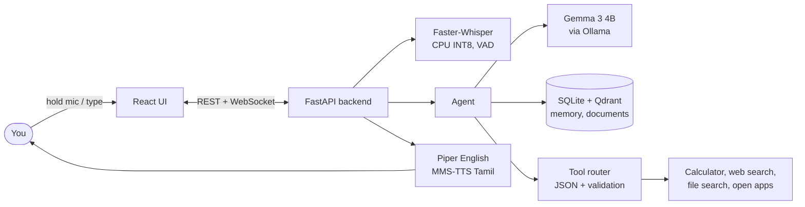

# Vaani — AI Personal Voice Assistant

A private voice assistant that runs entirely on your own Windows PC. Hold a button, speak English or Tamil, and Vaani
transcribes, remembers, searches your documents, uses tools, opens your apps and answers aloud.
No paid APIs and no cloud language model.

**Pipeline:** Listen → Transcribe → Understand → Retrieve memory → Think → Respond → Speak



| Layer | Technology |
|---|---|
| UI | React + Vite, Tailwind CSS v4, Framer Motion, Lucide |
| Backend | Python 3.12, FastAPI, REST + WebSocket |
| LLM | Gemma 3 4B (`gemma3:4b`) through Ollama, 4096-token context |
| Speech to text | Faster-Whisper `small`, CPU, INT8, voice-activity detection, English + Tamil |
| Text to speech | Piper (English, in-process) · MMS-TTS Tamil (default) or AI4Bharat Indic-TTS (optional) |
| Storage | SQLite (chats, settings) · embedded Qdrant (memories, documents) |
| Embeddings | all-MiniLM-L6-v2 on CPU |
| Other | PyMuPDF (PDF), PyAutoGUI (media keys, screenshots), `ddgs` (key-less web search) |

## Status: what has been verified

Everything in the left column was run by the author on the target machine (Windows 11, RTX 3050 4 GB, 24 GB RAM,
`gemma3:4b`). The full checklist with a Result column is in [TESTING.md](TESTING.md).

| Confirmed working | Not yet confirmed |
|---|---|
| Streaming chat, history, React UI, WebSocket reconnect | The yellow confirmation card in the browser (the API flow behind it is verified) |
| Push-to-talk (button and Space), English and Tamil transcription | Time tool, file search and folder creation by voice |
| English speech (Piper, in-process) | Indic-TTS engine (optional alternative) |
| Tamil speech (MMS-TTS) with Praat voice conversion and adjustable pitch | Long-running stability |
| Long-term memory: save, recall, restart, delete | |
| Document Q&A incl. "not found" and deleted files | |
| Calculator, web search, opening apps (Start-menu import) | |
| Delete safety, checked through the API by the live smoke test: a delete asks first, Deny keeps the folder, Approve deletes it, confirmations work once only, the Desktop and Windows files ask first, unlisted apps and `javascript:` links are refused | |
| One-command launcher (`start_all.ps1`, `stop_all.ps1`) | |

Automated tests: `python -m unittest discover -s tests -t .` — no models needed except the optional Qdrant test.
Live check of the running system (chat, memory, documents, both voices, speech recognition and the delete-confirmation flow):
`python scripts\smoke_test.py`. A demo walkthrough is in [DEMO.md](DEMO.md).

## 1. Setup (Windows PowerShell)

Prerequisites: Python 3.12, Node.js, Git, [Ollama](https://ollama.com/download) with `ollama pull gemma3:4b`.

```powershell
cd "C:\path\to\AI-Personal-Voice-Assistant"
powershell -ExecutionPolicy Bypass -File scripts\setup.ps1
python scripts\check_env.py
```

`setup.ps1` creates `.venv`, installs CPU PyTorch and the requirements, copies `.env.example` to `.env`, downloads the
Piper English voice and runs `npm install`. Whisper and MiniLM download from Hugging Face on first use (internet needed once).

## 2. Run

```powershell
powershell -ExecutionPolicy Bypass -File scripts\start_all.ps1 -Tamil
```

Starts Ollama if needed, the backend, the Tamil voice service (`-Tamil`, optional) and the frontend, waits until each
answers, then opens http://localhost:5173. Safe to run twice. Stop everything (Ollama keeps running) with
`scripts\stop_all.ps1`. API docs: http://127.0.0.1:8000/docs. Run only **one** backend at a time: embedded Qdrant locks its folder.

Manual alternative, one terminal each: `scripts\start_backend.ps1`, `scripts\start_frontend.ps1`, `scripts\start_tamil_tts.ps1`.

## 3. Using Vaani

- **Talk:** hold the mic button or hold **Space** (when no text box is focused), speak, release. Type if you prefer.
- **Language:** Auto, English or தமிழ் (top right). For English-only use choose English: it is faster. For Tamil choose தமிழ் for the best transcription.
- **Memory:** say "remember that…" or mention facts about yourself; review and delete them on the Memory page.
- **Documents:** upload PDF, TXT or MD on the Documents page, then ask about them. If the answer is not in the files Vaani says so.
- **Tools:** calculator, current time, web search, find files, create folders, open apps and websites, media keys.
  Deleting always asks for confirmation (a yellow card). The Tools page can require confirmation for every desktop action.

## 4. Opening apps

Vaani opens only apps on an allow-list, never an arbitrary command. A short built-in list exists (Notepad, Chrome, …).
To add your installed apps:

```powershell
powershell -ExecutionPolicy Bypass -File scripts\import_start_apps.ps1 -DryRun   # preview, writes nothing
powershell -ExecutionPolicy Bypass -File scripts\import_start_apps.ps1           # write data\apps.json
```

- The spoken name is the Start-menu name: "open docker", "open sticky notes", "open Power BI".
- Matching is forgiving but never guesses: if several different apps fit, Vaani says "Did you mean…".
- The importer skips uninstallers, backup/restore/database start-stop shortcuts, remote-access tools, system-state tools
  (registry editor, disk cleanup, …) and documentation links. Edit the `$risky` / `$noise` lines in the script to change that.
- Add one app by hand in `data\apps.json` (`"name": "AppID or exe or path"`); find AppIDs with `Get-StartApps`.
  Values may contain only letters, digits, spaces and `. : \ / ( ) { } ! _ -`; anything else is ignored.

## 5. Tamil speech

Tamil replies always show as text. To hear them, run the Tamil voice service (`start_all.ps1 -Tamil`):

- **Default engine: MMS-TTS Tamil** (`facebook/mms-tts-tam`, CC-BY-NC 4.0, non-commercial). Runs on CPU in the main `.venv`; the
  model downloads on first start. Digits and Latin letters inside Tamil sentences are not spoken.
- **AI4Bharat Indic-TTS** is still supported (`$env:TAMIL_TTS_ENGINE = "indic"`, separate `.venv-tamil`) but follows a Linux/conda
  setup and is **not verified on Windows**.
- **Female voice:** MMS has one male-sounding voice, so Vaani converts it with Praat's "Change gender" (pitch and formants together).
  Settings → *Tamil voice pitch* controls it: 1.00 is the original male voice, the default 1.50 is more feminine, and the **Test** button plays a sample.
  It needs `pip install praat-parselmouth` (listed in `requirements.txt`); without it a cruder fallback is used, capped at 1.3×.
  This is voice processing, not a true female neural voice. A native female Tamil voice (for example Indic Parler-TTS) would need a much
  larger model, which is probably too slow on this hardware (not measured).
- Service off? Vaani falls back to text within about 2 seconds.

## 6. Performance (measured on the author's PC, 2026-11-13)

Windows 11, RTX 3050 Laptop 4 GB, 24 GB RAM, `gemma3:4b`, context 4096. Re-create the table with
`python scripts\log_report.py --markdown` and `python scripts\resource_report.py --seconds 90`.

| Measurement | Result |
|---|---|
| Text generation | about 20 tokens/s (p95 22) |
| Time to first word, typical text question | about 1.1–1.6 s (a question with 3 document excerpts: about 2.1 s) |
| English speech synthesis (Piper) | median 0.13 s per sentence |
| Tamil speech synthesis (MMS-TTS) | about 1.8 s per sentence (small sample) |
| Speech recognition (before the English-beam tuning) | median 3.0 s per utterance (English 3.1, Tamil 2.6) |
| Mic release to first spoken word (English) | about 4.7 s + about 1 s while the first sentence is written |
| Tool request (router + tool) | about 2.3 s extra |
| Gemma placement | 44% on the GPU (1.5 of 3.3 GB), the rest on the CPU |
| GPU memory in use | 3.6–3.7 of 4.1 GB (other apps hold part of it) |
| RAM used by Vaani | Ollama 3.3 GB, backend 0.7 GB, Tamil service 0.2 GB, frontend 0.1 GB |

Tuning knobs (Settings page or `.env`): context window, max reply length, Whisper model, `VAANI_WHISPER_BEAM` (Tamil/Auto),
`VAANI_WHISPER_BEAM_EN` (English), `VAANI_WHISPER_THREADS`. Closing other GPU-hungry apps lets more of Gemma run on the GPU.

## 7. Safety

- Tools are a fixed allow-list; the model can only choose a tool name and fill declared arguments, which are validated.
- Deleting always requires approval. Only single files or empty folders can be deleted, only inside your user folder;
  top-level folders are protected.
- Desktop actions (open app, folder, website, key) reply with the tool's own text, so a language model can never misreport
  what happened.
- Apps open only from the allow-list; websites must be http(s). Nothing runs a user-supplied command line.
- Everything stays on your PC, except web search, which sends your query to a search engine.

## 8. Troubleshooting

| Symptom | Fix |
|---|---|
| `Ollama returned 500 … llama-server.exe … corrupted` | Reinstall Ollama (uninstall, delete `%LOCALAPPDATA%\Programs\Ollama`, install). Your models in `%USERPROFILE%\.ollama` stay. |
| "Cannot reach Ollama" | Start Ollama (`ollama serve`) or use `start_all.ps1`. |
| Backend will not start: Qdrant "already accessed" | A second backend is running. Run `scripts\stop_all.ps1`. |
| Tamil words slightly wrong | Set the language to தமிழ், keep `VAANI_WHISPER_BEAM=5`; try Whisper `medium` in Settings (slower). |
| First reply after a start is slow | Models are still loading; wait about 10 s after "startup complete". |
| No spoken reply | Settings → System status shows the Piper / Tamil voice state. |
| An app will not open | Check the name in the refusal message; add it to `data\apps.json`. |

## 9. Known limitations

- MiniLM is English-focused, so Tamil memory and document retrieval is weaker. Automatic memories are stored in English to help.
- Transcription appears when you release the button (Whisper is not streamed). Push-to-talk only; no wake word.
- Scanned PDFs need OCR, which is not included.
- Gemma 3 4B can still make mistakes or over-trust search results on borderline questions. Review automatic memories on the Memory page.
- Tool and action replies are in English even when you speak Tamil.
- Only 44% of the model fits the 4 GB GPU, so speech recognition and the first word dominate the wait.

## 10. Project layout

```
backend/   api/ brain/ voice/ memory/ documents/ tools/ core/    FastAPI app (uvicorn backend.main:app)
frontend/  src/{components,pages,hooks,services}                 React + Vite UI
services/tamil_tts/                                              optional Tamil voice service
scripts/   setup, start_all/stop_all, import_start_apps, check_env, benchmarks, log_report, resource_report
tests/     unit + integration tests         postman/   API collection
data/      database, qdrant memory, documents, models, logs, apps.json (git-ignored)
```
Logs: `data\logs\vaani.log`. Config: `.env` ([.env.example](.env.example)) and the Settings page.
